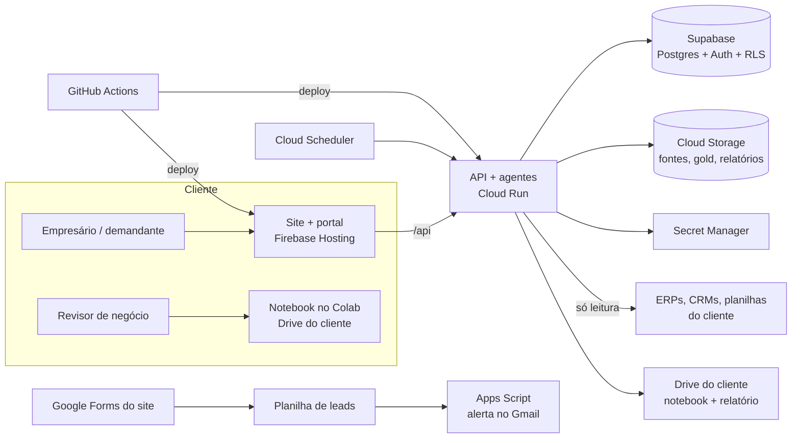

# Plano de nuvem · primeira versão do Lastro

Status: proposta · 25/11/2026 · **em vigor o plano B (ADR 0009: Render + Supabase Storage + GitHub Actions) enquanto o faturamento do Google estiver bloqueado** · decisão em `docs/adr/0006-infra-v1-gratuita.md` · cards no épico OPS do Jira.

## Resumo

A v1 roda inteira em planos gratuitos: **Firebase Hosting** (site e portal), **Cloud Run** (API e agentes), **Supabase** (login e banco com RLS), **Cloud Storage** (arquivos de cada empresa), **Secret Manager** (segredos) e **GitHub Actions** (deploy). O atendimento usa **Gmail, Agenda, Forms, Planilhas, Drive, Colab, Meet e Looker Studio**, mais o WhatsApp que já é o canal oficial.

A Vercel não entra em produção: o plano Hobby é limitado a uso pessoal e não comercial, e todo uso comercial exige o plano Pro ([política de uso justo](https://vercel.com/docs/limits/fair-use-guidelines), [plano Hobby](https://vercel.com/docs/plans/hobby)). Ela fica como opção paga (Pro) se um dia precisarmos dos recursos dela.

## Arquitetura



## O que fica onde e o que é grátis

| Peça | Serviço | Limite gratuito conferido | Atenção |
| --- | --- | --- | --- |
| Site e portal (estático) | Firebase Hosting (Spark) | 10 GB armazenados, 360 MB/dia de transferência, domínio próprio com SSL ([preços Firebase](https://firebase.google.com/pricing)) | Imagens do site em JPEG leve; o portal é pequeno |
| API e agentes | Cloud Run | 2 milhões de requisições/mês ([camada gratuita](https://docs.cloud.google.com/free)) | Escala a zero: primeira requisição do dia demora alguns segundos; modelo de embeddings (240 MB) carregado do Cloud Storage na subida |
| Login e banco | Supabase Free | 500 MB por projeto, 2 projetos ativos ([preços](https://supabase.com/pricing)) | Projeto parado por 1 semana é pausado ([pausa](https://supabase.com/docs/guides/platform/free-project-pausing)): job diário mantém ativo |
| Arquivos por empresa | Cloud Storage | 5 GB-mês (Standard) ([camada gratuita](https://docs.cloud.google.com/free)) | Gratuito só em regiões dos EUA: registrar na política de privacidade (LGPD, transferência internacional) |
| Segredos | Secret Manager | 6 versões ativas ([camada gratuita](https://docs.cloud.google.com/free)) | `LASTRO_SEGREDO`, chave do Supabase, chave do LLM; credenciais de cliente ficam no Vault do Supabase |
| Análises pesadas e trilha Google | BigQuery sandbox | 1 TB de consulta/mês ([camada gratuita](https://docs.cloud.google.com/free)) | Opcional na v1 |
| Agendamento | Cloud Scheduler | a confirmar na página de preços | Keepalive do Supabase e cargas incrementais |
| Deploy | GitHub Actions | minutos gratuitos do plano do GitHub | Autenticação no Google por Workload Identity, sem chave guardada |

**Pré-requisito que não é opcional:** o Google Cloud exige uma conta de faturamento (cartão) mesmo para ficar na camada gratuita. Primeira tarefa: criar orçamento com alerta em R$ 1 e R$ 10.

## Atendimento completo com ferramentas gratuitas do Google

| Momento do cliente | Ferramenta | Como funciona |
| --- | --- | --- |
| Chega pelo site | Google Forms + Planilhas | Botão "testar com os meus dados" abre um formulário curto (empresa, sistema que usa, pergunta que mais pesa). Cada resposta cai numa planilha de leads. |
| Equipe fica sabendo | Apps Script + Gmail | Script na planilha envia e-mail para lixumlabs@gmail.com com o lead e o link do WhatsApp. |
| Marca a conversa | Agenda (página de agendamento) | Link de agendamento no e-mail de resposta; reunião no Meet. |
| Piloto | Drive + Colab | Uma pasta por cliente, compartilhada com o revisor dele. O Lastro grava ali o relatório e o notebook da camada 2. |
| Acompanha resultados | Looker Studio | Painel lendo o gold do cliente (Planilhas ou BigQuery), sem licença. |
| Conversa do dia a dia | WhatsApp (já oficial) + Gmail | Respostas-modelo no Gmail para os pedidos mais comuns. |

Ferramentas de conta pessoal do Google têm limites (por exemplo, reuniões em grupo do Meet com duração limitada). O Google Workspace pago entra quando houver mais de uma pessoa atendendo.

## Fases (cards do épico OPS)

| Card | O que | Depende de | Quem faz o passo manual |
| --- | --- | --- | --- |
| LST-19 | Conta Google Cloud, projeto `lastro-prod`, orçamento com alerta | — | Tiago (cartão, aceite dos termos) |
| LST-20 | Container da API (Dockerfile, health check, modelo vindo do Cloud Storage) | — | — |
| LST-21 | Arquivos das empresas no Cloud Storage e sandbox com acesso externo desligado (feito; ADR 0007) | LST-20 | — |
| LST-6 | Supabase em produção e keepalive diário | LST-19 | Tiago (criar projeto) |
| LST-22 | Deploy da API no Cloud Run pelo GitHub Actions, segredos no Secret Manager | LST-19, LST-20, LST-21, LST-6 | Tiago (autorizar Workload Identity) |
| LST-23 | Site e portal no Firebase Hosting, `/api` apontando para o Cloud Run, domínio | LST-22 | Tiago (DNS do domínio) |
| LST-24 | Funil de atendimento: Forms → Planilha → Apps Script → Gmail → Agenda | — | Tiago (conta Google) |
| LST-25 | Entregas no Drive do cliente (relatório e notebook do Colab) | LST-22 | — |
| LST-26 | Monitoramento: verificação de disponibilidade, alerta de erro e de custo | LST-22 | — |

## Bucket das empresas no Cloud Run (ADR 0007)

O deploy do LST-22 monta o bucket como volume e aponta o Lastro para ele:

```bash
gcloud run deploy lastro-api --image <imagem> --region us-central1 \
  --execution-environment gen2 --max-instances 2 --min-instances 0 \
  --add-volume name=tenants,type=cloud-storage,bucket=<bucket> \
  --add-volume-mount volume=tenants,mount-path=/dados/tenants \
  --set-env-vars LASTRO_AMBIENTE=producao,LASTRO_TENANTS=/dados/tenants
```

A conta de serviço da API precisa do papel `roles/storage.objectUser` só nesse bucket. Os nomes das flags e a exigência de `gen2` devem ser conferidos na documentação do Cloud Run no dia do deploy.

## Cargas agendadas (LST-7)

Um job do Cloud Scheduler chama a API de hora em hora; ela roda só as cargas que estão no horário (America/Sao_Paulo):

```bash
gcloud scheduler jobs create http lastro-cargas --location us-central1 --schedule "5 * * * *" \
  --uri https://<api>/tarefas/cargas --http-method POST \
  --headers X-Lastro-Tarefa=<valor de LASTRO_TAREFA_SEGREDO>
```

`LASTRO_TAREFA_SEGREDO` (32+ caracteres) fica no Secret Manager e é passado ao Cloud Run como variável. Sem ele, a rota responde 503 e nada roda. O mesmo job pode servir de keepalive do Supabase.

## Riscos

| Risco | Efeito | Mitigação |
| --- | --- | --- |
| Uso comercial na Vercel Hobby | Suspensão do projeto | Produção no Firebase Hosting (ADR 0006) |
| Supabase pausa por inatividade | Portal fora do ar | Job diário no Cloud Scheduler |
| Partida a frio do Cloud Run com o modelo de 240 MB | Primeira busca do dia lenta | Embeddings desligados na v1 ou modelo carregado em segundo plano |
| Dados de cliente em região dos EUA | Exigência da LGPD | Cláusula de transferência internacional; região do Brasil quando houver receita |
| Duas instâncias gravando o mesmo arquivo no bucket | Última gravação vence | Máx. 2 instâncias; notas de decisão pequenas (ADR 0007) |
| Estourar limite gratuito | Cobrança | Orçamento com alerta, cotas máximas no Cloud Run (instâncias máx. 2) |
